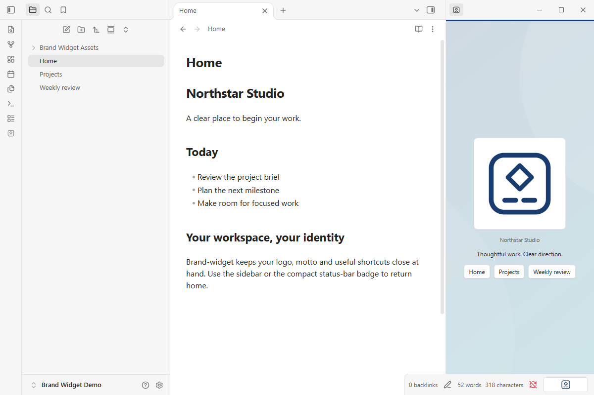
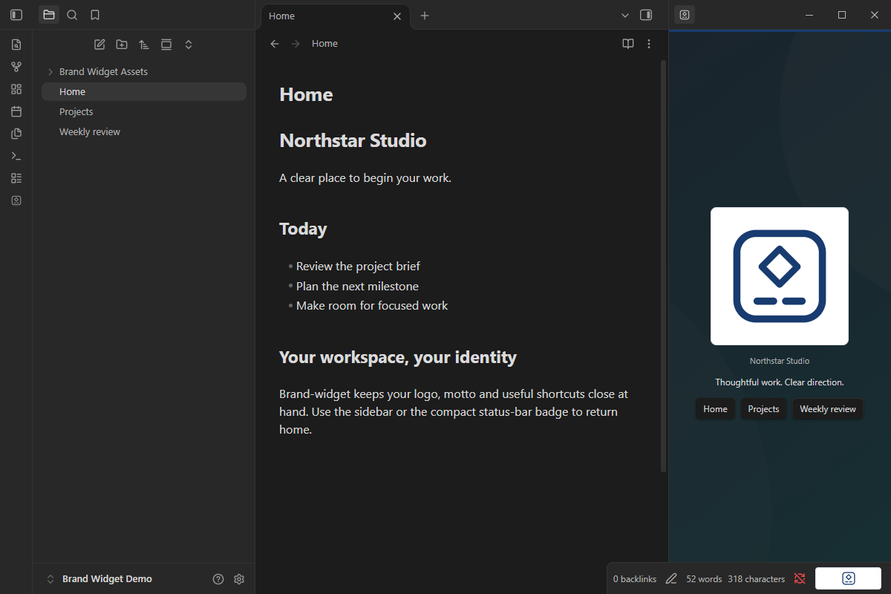
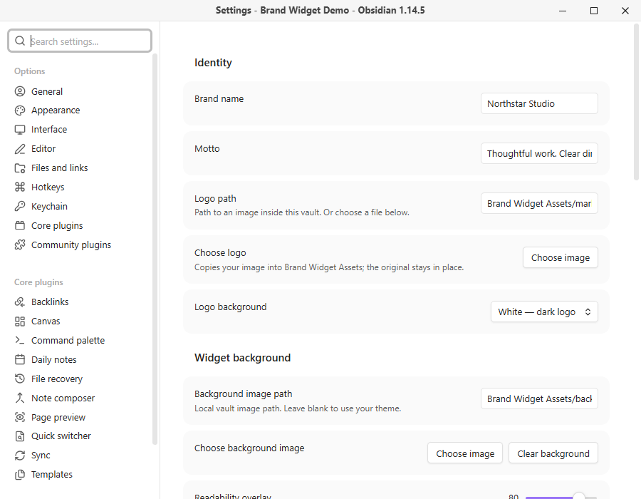

# Brand-widget

Personalize your Obsidian workspace with a logo, motto and quick links in a sidebar widget and status-bar badge.

## Features

- Choose a logo from your device or an image already in your vault.
- Set your brand name, motto and quick links to notes, headings or websites.
- Use a custom background with a theme-colored readability overlay.
- Adjust colors, logo size and white, theme or transparent logo backing.
- Opt into a slow spin, gentle bounce, soft dissolve or subtle float. Each effect rests between cycles; controls stay still.
- Pause motion on hover or keyboard focus and honor system reduced-motion preferences.
- Open your preferred note or website from the status bar.

## Screenshots

Light and dark themes, captured in a separate demo vault in Obsidian 1.14.5. No company records or personal branding are included.





## Install

Install from the [Obsidian Community listing](https://community.obsidian.md/plugins/brand-widget), or open Settings → Community plugins → Browse and search for Brand-widget.

For manual installation:

1. Download the ZIP from [GitHub Releases](https://github.com/dernestbank/obsidian-brand-widget/releases).
2. Extract the `brand-widget` folder into your vault's `.obsidian/plugins/` directory.
3. Restart Obsidian and enable **Brand-widget** under **Settings → Community plugins**.
4. Open **Settings → Brand-widget**, enter your name and motto, then choose a logo.
5. Run **Brand-widget: Show sidebar widget**. Drag its tab to the sidebar section you prefer, for example below a timer. Obsidian saves the placement.

Requires Obsidian **1.14.5 or newer on desktop** for this release. Mobile is not advertised until separately tested. The sidebar panel appears while its section is open; closing the sidebar hides its contents.

## Configure

Quick-link destinations can be `Home.md`, `Projects/Plan#Next actions`, or `https://example.com`. Other URL schemes are rejected. Images can be PNG, JPEG, WebP, GIF or SVG, up to 10 MB on import. The file picker copies images into `Brand Widget Assets`; originals stay unchanged. An existing vault-relative path also works. Rename images inside Obsidian to keep configured paths updated.

The image background supports **Fill panel** or **Show whole image**. Use the readability overlay to keep text clear. Missing images fall back to the theme background or brand name. Logo animations default to off; status-bar motion is a separate opt-in. Reduced motion disables plugin-generated effects, but cannot pause animation embedded in a user-provided GIF.

## Privacy

No account, payment, telemetry, automatic updates or background network requests. The plugin accesses vault images and the specific device image you select through the file picker. It does not scan other device files. External websites open only when you click a configured link. SVGs are displayed as images, never inserted as HTML. Personal settings and images are not bundled with the public plugin.

## Develop

The runtime is readable CommonJS JavaScript; `main.js` is both the source and release artifact. No compilation is required. Node.js 24 or newer is used for development tooling only.

```sh
pnpm install --frozen-lockfile
pnpm run check
pnpm test
pnpm run lint
pnpm run format:check
pnpm run release
```

Release files are generated in `dist/1.1.2/`. Upload **main.js**, **manifest.json** and **styles.css** individually to a GitHub release tagged **1.1.2**. The ZIP is an additional manual-install convenience. See [release instructions](docs/RELEASING.md) and [validation record](docs/VALIDATION.md).

## Support and license

[Report a bug or request a feature](https://github.com/dernestbank/obsidian-brand-widget/issues). Maintained by [dernestbank](https://github.com/dernestbank). MIT licensed; supplied brand assets remain the property of their owners. This is an independent community plugin, not an official Obsidian product.
